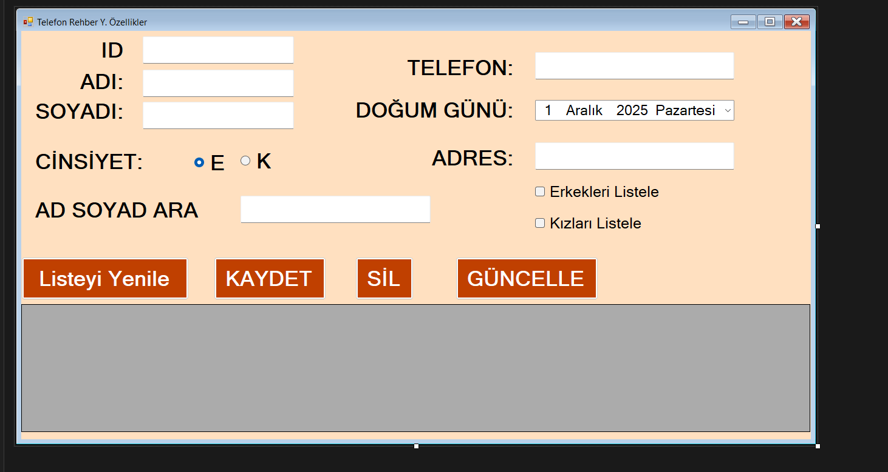

# 📞 Telefon Rehberi Uygulaması

## 📖 Proje Hakkında

Bu proje, **C#** ve **Windows Forms** kullanılarak geliştirilmiş, **Entity Framework** altyapısı ile veritabanı bağlantısı sağlayan kapsamlı bir rehber yönetim sistemidir.

Kullanıcıların kişi bilgilerini dijital ortamda saklamasını, düzenlemesini ve anlık olarak filtrelemesini sağlar. Klasik CRUD işlemlerinin yanı sıra, cinsiyete göre özelleştirilmiş filtreleme ve dinamik arama özellikleri içerir.

---

## 📸 Proje Ekran Görüntüsü

---

## 🚀 Özellikler

Uygulama aşağıdaki temel fonksiyonları içermektedir:

* **💾 CRUD İşlemleri:**
    * **Ekle:** Ad, soyad, telefon, doğum günü, adres ve cinsiyet bilgileriyle yeni kayıt oluşturma.
    * **Sil:** Seçili kişiyi rehberden kalıcı olarak kaldırma.
    * **Güncelle:** Mevcut kişi bilgilerini düzenleme.
    * **Listele:** Veritabanındaki tüm kayıtları `DataGridView` üzerinde görüntüleme.

* **🔍 Gelişmiş Arama ve Filtreleme:**
    * **Dinamik Arama:** "Ad Soyad Ara" kutusu ile anlık veri süzme.
    * **Kategorik Filtreleme:** Checkboxlar yardımıyla sadece "Erkekleri" veya "Kızları" listeleme özelliği.

* **📅 Tarih Yönetimi:**
    * Doğum günü verileri için `DateTimePicker` entegrasyonu.

---

## 🛠 Teknik Detaylar

* **Programlama Dili:** C#
* **Arayüz (UI):** Windows Forms Application
* **Veritabanı:** Microsoft SQL Server (`DbTelRehberB`)
* **Veri Erişimi (ORM):** Entity Framework (Model First / DB First Yaklaşımı)
* **Tablo Yapısı:** `TBLKISILER` (ID, AD, SOYAD, TEL, DOGUMGUNU, ADRES, CINSIYET)

---

## ⚙️ Kurulum ve Çalıştırma

1.  Projeyi bilgisayarınıza indirin (Clone veya Download ZIP).
2.  SQL Server'da `Veri Tabanı` klasöründeki `.bak` dosyasını Restore ederek veritabanını oluşturun.
3.  `App.config` dosyasındaki **connectionString** değerini kendi yerel sunucunuza (`Data Source=.; ...`) göre güncelleyin.
4.  Projeyi Visual Studio üzerinden başlatın.

---

## 👤 Lisans

Bu proje [MIT](LICENSE) lisansı altında sunulmuştur.