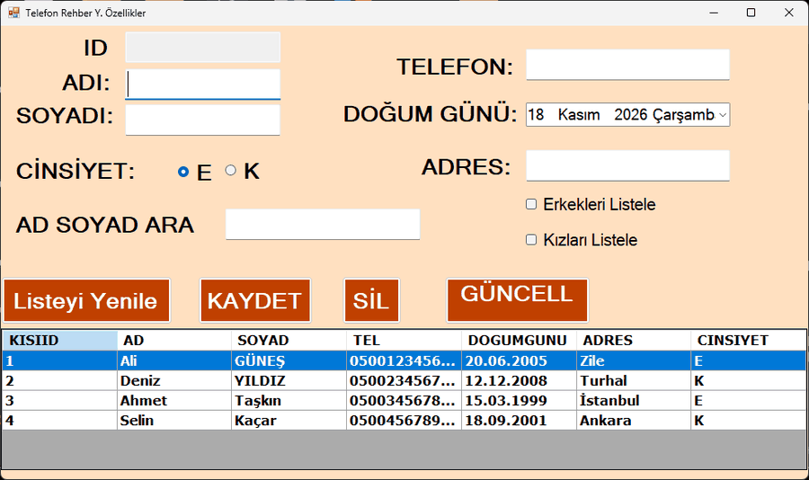
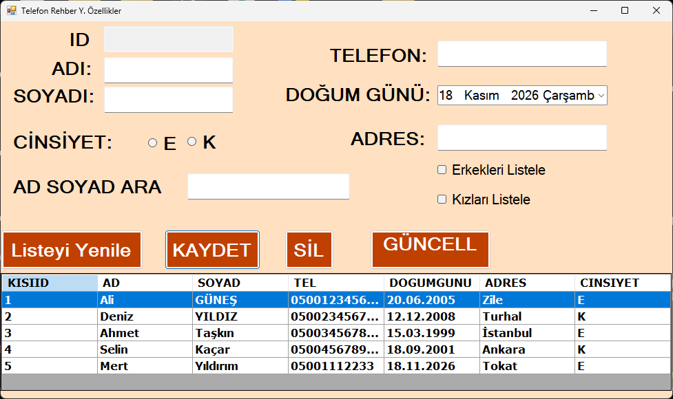
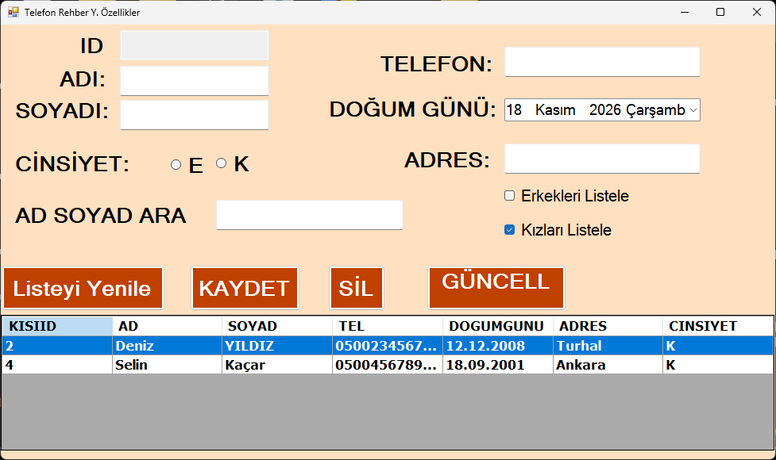

# 📞 Telefon Rehberi Uygulaması


## 📖 Proje Hakkında

**C#** ve **Windows Forms** ile geliştirilmiş, **Entity Framework 6 (Database First)** üzerinden **SQL Server** veritabanına bağlanan bir rehber yönetim uygulamasıdır.

Kişi bilgilerini saklar, düzenler ve anlık olarak filtreler. Temel CRUD işlemlerine ek olarak ad/soyad ile canlı arama ve cinsiyete göre filtreleme sunar.

---

## 🎬 Demo



Yeni kişi ekleme, ad/soyad ile canlı arama ve cinsiyete göre filtreleme.

| Yeni kişi eklendi | Kızları listele filtresi |
| --- | --- |
|  |  |

> Görüntüler, depodaki kurulum script'iyle kurulan örnek veritabanı üzerinde uygulama çalıştırılarak alınmıştır.


## 🚀 Özellikler

* **💾 CRUD İşlemleri**
    * **Kaydet:** Ad, soyad, telefon, doğum günü, adres ve cinsiyet ile yeni kayıt ekler. Ad, soyad, telefon ve cinsiyet zorunludur.
    * **Sil:** Listeden seçilen kişiyi onay aldıktan sonra siler.
    * **Güncelle:** Seçilen kişinin bilgilerini düzenler.
    * **Listele:** Tüm kayıtları `DataGridView` üzerinde gösterir. Bir satıra tıklayınca bilgiler form alanlarına gelir.
* **🔍 Arama ve Filtreleme**
    * **Ad Soyad Ara:** Yazdıkça ad veya soyada göre listeyi süzer.
    * **Erkekleri / Kızları Listele:** Checkbox ile cinsiyete göre filtreler. Arama ile birlikte çalışır; ikisi birden işaretlenirse herkes listelenir.
    * **Listeyi Yenile:** Formu, aramayı ve filtreleri sıfırlar.
* **📅 Tarih Seçimi:** Doğum günü için `DateTimePicker` kullanılır.
* **🛡️ Hata Kontrolü:** Kişi seçmeden Sil/Güncelle'ye basmak, boş alan bırakmak veya veritabanına bağlanamamak uygulamayı çökertmez; kullanıcıya uyarı gösterilir.

---

## 🛠 Teknik Detaylar

| | |
| --- | --- |
| **Dil** | C# |
| **Arayüz** | Windows Forms (.NET Framework 4.7.2) |
| **Veri erişimi** | Entity Framework 6.2 – Database First (`Model1.edmx`) |
| **Veritabanı** | Microsoft SQL Server – `DbTelRehberB` |
| **Tablo** | `TBLKISILER` |

**`TBLKISILER` tablosu**

| Kolon | Tip | Açıklama |
| --- | --- | --- |
| `KISIID` | `int` (PK, identity) | Otomatik artan kimlik |
| `AD` | `nvarchar(30)` | Ad |
| `SOYAD` | `nvarchar(30)` | Soyad |
| `TEL` | `char(15)` | Telefon |
| `DOGUMGUNU` | `smalldatetime` | Doğum tarihi |
| `ADRES` | `nvarchar(50)` | Adres |
| `CINSIYET` | `char(1)` | `E` / `K` |

### 📂 Proje Yapısı

```
Telefon-Rehberi-Uygulamasi/
├── TelRehber OtomasyonB.sln          ← Visual Studio çözüm dosyası
├── TelRehber OtomasyonB/
│   ├── Form1.cs                      ← Arayüz olayları: CRUD, arama, filtreleme
│   ├── Form1.Designer.cs             ← Form tasarımı
│   ├── Model1.edmx                   ← Entity Framework modeli
│   ├── TBLKISILER.cs                 ← Tablo sınıfı (EF tarafından üretilir)
│   ├── App.config                    ← Bağlantı cümlesi (connection string)
│   └── packages.config               ← NuGet paketleri (EntityFramework 6.2.0)
└── Veri Tabanı/
    ├── DbTelRehberB.sql              ← Kurulum script'i (önerilen)
    ├── DbTelRehberB.bak              ← SQL Server 2022 yedeği
    └── DbTelRehberB.mdf / _log.ldf   ← Veritabanı dosyaları (Attach için)
```

---

## ⚙️ Kurulum ve Çalıştırma

### Gereksinimler

* **Visual Studio 2022** veya **Visual Studio 2026** – *.NET masaüstü geliştirme* iş yükü ve **.NET Framework 4.7.2 hedefleme paketi** kurulu olmalı
* **SQL Server** (Express veya Developer, 2022 ve üzeri)
* **SQL Server Management Studio (SSMS) 22**

### 1. Projeyi indirin

```bash
git clone https://github.com/GencayCeliker/Telefon-Rehberi-Uygulamasi.git
```

veya GitHub'da **Code → Download ZIP**.

### 2. Veritabanını oluşturun (SSMS 22)

**Yöntem A – SQL script (önerilen)**

1. SSMS 22'yi açın ve SQL Server'a bağlanın (Server name: `.\SQLEXPRESS` ya da `localhost`, Authentication: *Windows Authentication*).
2. **File → Open → File...** ile `Veri Tabanı/DbTelRehberB.sql` dosyasını açın.
3. **Execute (F5)**'e basın. `DbTelRehberB` veritabanı, `TBLKISILER` tablosu ve 4 örnek kayıt oluşur.

**Yöntem B – Yedekten geri yükleme (.bak)**

1. `DbTelRehberB.bak` dosyasını SQL Server'ın okuyabileceği bir klasöre kopyalayın (ör. SQL Server'ın kendi `...\MSSQL\Backup` klasörü veya `C:\Users\Public`).
   > Masaüstü / OneDrive klasöründen doğrudan restore etmeye çalışırsanız *"Operating system error 5 (Erişim engellendi)"* hatası alırsınız; bu yüzden kopyalamak gerekir.
2. Object Explorer'da **Databases → sağ tık → Restore Database...**
3. **Device → ...** ile `.bak` dosyasını seçip **OK**'a basın.
4. Yedek **SQL Server 2022** ile alınmıştır; daha eski sürümlere geri yüklenemez. Eski bir sürüm kullanıyorsanız Yöntem A'yı kullanın.

### 3. Bağlantı cümlesini kontrol edin

`TelRehber OtomasyonB/App.config` içinde varsayılan sunucu **`.\SQLEXPRESS`**'tir:

```xml
<add name="DbTelRehberBEntities2"
     connectionString="metadata=res://*/Model1.csdl|res://*/Model1.ssdl|res://*/Model1.msl;provider=System.Data.SqlClient;provider connection string=&quot;data source=.\SQLEXPRESS;initial catalog=DbTelRehberB;integrated security=True;trustservercertificate=True;MultipleActiveResultSets=True;App=EntityFramework&quot;"
     providerName="System.Data.EntityClient" />
```

SQL Server'ınız varsayılan örnekse (`MSSQLSERVER`) `data source=.\SQLEXPRESS` kısmını `data source=.` olarak değiştirin. Sunucu adınızı SSMS'in bağlantı penceresinde görebilirsiniz.

### 4. Visual Studio ile çalıştırın

1. `TelRehber OtomasyonB.sln` dosyasını Visual Studio ile açın.
2. NuGet paketleri ilk derlemede otomatik geri yüklenir. Yüklenmezse: **Solution Explorer → çözüme sağ tık → Restore NuGet Packages**.
3. **Build → Build Solution** (`Ctrl+Shift+B`), ardından **Start** (`F5`).

---

## ❓ Sık Karşılaşılan Sorunlar

| Sorun | Çözüm |
| --- | --- |
| Açılışta *"Veritabanına bağlanılamadı"* uyarısı | SQL Server servisinin çalıştığından ve `App.config` içindeki `data source` değerinin doğru olduğundan emin olun. |
| `EntityFramework` referansı bulunamadı | **Restore NuGet Packages** çalıştırın. |
| *.NET Framework 4.7.2 targeting pack* bulunamadı | Visual Studio Installer → **Modify → Individual components** → *.NET Framework 4.7.2 targeting pack* kurun. |

---

## 👤 Lisans

Bu proje [MIT](LICENSE) lisansı altında sunulmuştur.
